<p align="center">
  
</p>

# Auto-Research System 🔨

[](LICENSE) · [](README_CN.md) · [](#-whats-inside) · [](.claude/skills/shared-references/integrity-patterns.md) · [](#-quickstart)

<div align="center">

### 🔨 科研的门槛，吾辈来拆 —— 让每个想去工业界的人都拿得出一篇站得住的论文。

***Research should not be a gate. We take it down, so everyone heading into industry can bring a paper that holds up.***

</div>

> An end-to-end research system for Claude Code: from a research objective to
> a selected topic, verified literature, a planned and piloted experiment, an
> honest analysis and a submission-ready paper with figures, citations and a
> reproduction package. 37 skills, one research controller, and human checkpoints
> where the decisions matter.

What it gives you:

- **The whole path, not one step.** Topic selection, literature and novelty
  checks, venue and benchmark choice, experiment design, implementation and
  pilots, analysis, writing, figures, limitations and AI-use drafts, review and
  rebuttal. Each stage is a skill you can call on its own, or the controller runs
  them in order.
- **Evidence before claims.** Every number traces to a raw result file; every
  citation is verified; claims stay at the strength the evidence supports.
- **You stay in charge.** Topic approval, spending, compute, submission and any
  outward-facing action wait for you.
- **No vendor lock-in.** The image provider and external reviewer are chosen in
  local configuration. The main agent handles authorized decisions directly.

---

## 🧭 What's inside

| | |
|---|---|
| **Skills** | 37 Claude Code skills in `.claude/skills/`. |
| **Shared research policies** | Claim preservation, contribution-type routing, target-venue calibration, topic selection, publication/version policy, research autonomy, abstract and conclusion rules, split review, and the [integrity pattern map](.claude/skills/shared-references/integrity-patterns.md). In `.claude/skills/shared-references/`. |
| **Research controller** | `.claude/skills/research-agent-team/`: one main agent coordinates stages within the current request; automatic mode runs the full flow only when you turn it on. |
| **Decision cards** | The main agent selects authorized options in automatic mode and records evidence, rationale and downstream effects in the existing task record. |
| **Specialist agents** | `.claude/agents/` (analyst, architect, implementer, QA, editor, requirements; brainstormer, idea critic, strategist). |
| **Literature helpers** | arXiv, OpenAlex, Semantic Scholar, Exa (`.agents/aris/tools/`). |
| **Codex reviewer bridge** | MCP server in `.agents/mcp-servers/codex-exec/` for cross-model review (optional; needs Codex CLI). |
| **Routing rules** | `CLAUDE.md`. |

---

## 📰 News

- **2026-11-01** — 🚀 **v1.0.** 37 Claude Code skills and the research
  controller; human checkpoints written into the routing rules; vendor-neutral
  image provider and external reviewer; an
  [integrity map](.claude/skills/shared-references/integrity-patterns.md) that
  ties each kind of paper defect to the stage that prevents it; a deterministic
  pre-check in `paper-claim-audit` (delta arithmetic, headline numbers missing
  from tables, GRIM, impossible SDs, p values contradicting their statistic,
  identical tables, leftover template strings).

---

## 🗺️ Workflow

```mermaid
flowchart TD
    U(["Your objective"]) --> T["1 · Topic selection<br/>brainstorming-research-ideas · research-companion<br/>idea-evaluator · novelty-check"]
    T --> H{"👤 Topic approval<br/>you decide; no model,<br/>default or timeout can"}
    H -- revise --> T
    H -- approved --> L["2 · Literature and evidence<br/>research-lit · deep-research<br/>nature-reader · nature-ref-verifier"]
    L --> D["3 · Venue, benchmark, design<br/>select-venue · benchmark-research-skill<br/>experiment-plan"]
    D --> P["4 · Implementation and minimum pilot<br/>experiment-bridge · run-experiment"]
    P --> G{"Pilot gate<br/>analyze-results"}
    G -- "stop or redesign" --> D
    G -- continue --> M["5 · Main experiments and analysis<br/>run-experiment · analyze-results<br/>failed and missing runs kept"]
    M --> W["6 · Argument and writing<br/>good-story · ts-paper-plan · paper-writer<br/>nature-figure · ts-paper-cite"]
    W -. "evidence gap" .-> M
    W --> X["7 · Limitations and disclosure drafts<br/>limitation-and-risk-writer · ai-use-drafter"]
    X --> V["8 · Revision and verification<br/>integrity pre-check → paper-claim-audit<br/>pre-submission-reviewer · paper-polish"]
    V -. "fix the evidence,<br/>not the wording" .-> M
    V --> F(["9 · Delivery<br/>manuscript, reproduction package,<br/>verification findings, open issues"])
    F --> O{"👤 Submit, publish, push<br/>only with your authorization"}

    classDef human fill:#FFF4CC,stroke:#B45309,color:#000
    classDef gate fill:#E8F5E9,stroke:#2E7D32,color:#000
    class H,O human
    class G gate
```



By default each request runs only the stages it needs and then stops; a
suggested next stage is not permission to continue. Automatic mode follows the
chart to the agreed endpoint and still stops at both 👤 checkpoints. Surveys,
theory, position and replication papers skip stages that do not apply.

---

## 🚀 Quickstart

```bash
git clone <this repository> research && cd research
./install.sh                 # WITH_DIAGRAMS=1 ./install.sh also sets up diagram rendering
claude
```

`install.sh` creates local, untracked configuration under `.tools/` from
`config/*.example.json` and renders host MCP configuration. Codex setup installs
the Claude reviewer MCP dependencies; no separate decision model is required. Requirements:
Python 3.10+, Node 18+ for image generation, and Claude Code. Codex CLI is
optional: it provides the external reviewer and the built-in image tool.

### Configure (all optional)

| Component | File | Choices | When unconfigured |
|---|---|---|---|
| Image generation | `.tools/image-provider.json` | Codex built-in `image_gen` (default) or Antigravity built-in `generate_image` (Nano Banana, `"provider": "antigravity"`); any OpenAI-compatible chat endpoint that returns images; adapters for Poe and OpenRouter | The built-in `image_gen` tool through the Codex bridge; if Codex or the tool is unavailable, generation is reported as unavailable |
| External reviewer | `.tools/reviewer.json` | Codex MCP with whatever provider your Codex CLI uses, or a manual reviewer | External review is reported as unavailable, never replaced by self-review |
| Language polish (optional) | none; used only when you ask | Gemini 4 Argon by default, through a Gemini tool exposed in the session (Antigravity `agy` MCP or Gemini CLI); language-only edits, each change reviewed before adoption | Polish stays with Claude |
| Literature APIs | environment variables | `EXA_API_KEY`, `SEMANTIC_SCHOLAR_API_KEY`, `OPENALEX_EMAIL` | Keyless sources are used and coverage gaps are reported |

Keys are always read from environment variables named in the configuration.
Set `RESEARCH_ROOT` to the repository path if you run helper scripts by hand.

---

## 🎯 Why

Getting a first paper out is where many people heading into industry get stuck:
the method is known, but turning an idea into a checked experiment, an honest
analysis and a paper a reviewer will accept takes skills that are rarely taught.
Agents can do much of that work. Left alone, they also produce papers that look
finished and do not hold up: an abstract number that no table contains, a "16%
gain" that is 6.7%, a baseline that was never tuned, a citation that does not
exist.

The system is built so that speed never comes from those shortcuts.

## 🔒 How it keeps the work honest

1. **Evidence before claims.** Every number in the paper traces to a raw result
   file. `paper-claim-audit` runs a fresh, zero-context, cross-model reviewer
   that sees only the paper source and the raw results.
2. **Fix the evidence, not the wording.** A finding is resolved by correcting the
   number, adding the missing run or baseline, or narrowing the claim
   ([claim preservation](.claude/skills/shared-references/claim-preservation.md)).
   Rewording so a check stops matching is never a fix.
3. **Every defect family has an owner.** The
   [integrity map](.claude/skills/shared-references/integrity-patterns.md) names
   the stage that prevents each kind of defect (numbers, scope, baselines,
   experiments, citations, presentation, proofs, evaluation design) and the check
   that catches it before submission.
4. **Pre-registered criteria stay fixed.** They are not changed after results
   are seen without disclosure; failed pilots stop downstream spending; failed
   and missing runs stay in the analysis.
5. **Humans keep the decisions that matter.** Approval of a newly selected topic
   always waits for you; no timeout, default or model can release it. Spending
   beyond an authorized budget, renting compute, pushing code, submitting and
   other outward-facing actions also need you.

## 🧭 How it behaves

- **One request, one scope.** A skill finishes the requested work and its
  necessary checks; a "next step" in a skill is not permission to continue.
- **Automatic mode** runs the full flow only when you explicitly turn it on for
  a task by typing `/research-auto [task and endpoint]`. The main agent directly selects and executes ordinary authorized
  choices, recording evidence and rationale. Topic approval and new authority
  remain with the user; independent external review is unchanged.

---

## ⚠️ Limits (read before trusting a run)

- **Tested:** host adapters (Codex view, Claude reviewer bridge, decider
  retirement; codex-exec reviewer bridge and `/research-auto`), image adapters (13),
  integrity pre-check (clean fixture plus 8 injected defects, and decimals
  without a leading zero),
  nature-response (7) and nature-shared (5) package checks. Most skills are
  instruction files without automated behavioural tests.
- **The integrity pre-check is regex-based.** It checks only what its extractor
  finds; zero findings is not a clean bill. Without scipy, only z-test p values
  are rechecked.
- **The integrity map is prevention, not proof.** Passing every check does not
  make a paper correct, and a reviewer may still find something.
- **Venue rules, deadlines and rankings** must be re-verified against official pages.

---

## 🧬 Acknowledgements

Several skills are adapted from open projects, including ARIS,
Supervisor-Skills, nature-skills, research-companion and AI-Research-SKILLs; the
integrity pre-check uses four MIT-licensed scripts from Anti-Autoresearch,
slightly modified. Each keeps its original notice; the full list with versions
and licenses is in [`THIRD_PARTY_NOTICES.md`](THIRD_PARTY_NOTICES.md).

## ⚖️ License

CC BY-NC-SA 4.0 ([`LICENSE`](LICENSE)): you may share and adapt this work for
non-commercial purposes with attribution, under the same license. Components
adapted from other projects keep their original notices; see
[`THIRD_PARTY_NOTICES.md`](THIRD_PARTY_NOTICES.md).

## Codex host

Run `bash install.sh --host codex`, then restart `codex` in this trusted project.
Codex executes, writes and polishes by default; Claude provides external review.
Split reviews use a Codex materials auditor and a Claude manuscript reviewer.
Scientific policy, stages, topic approval and artifact formats are unchanged.

Invoke `$paper-polish` or `$research-review`; `$research-auto` explicitly enables
automatic mode for the current task. `AGENTS.md` routes Codex, and
`python3 scripts/build_codex.py` regenerates `.agents/skills/` from the Claude
sources plus the [host contract](config/codex/host.md). Do not edit generated files.
The source currently contains 37 loadable skills; the
Codex view preserves all of them and adds the missing `research-auto` entrypoint.

The read-only Claude bridge requires an authenticated Claude CLI with print JSON,
effort selection, tool restriction and strict MCP configuration support. Configure
`.tools/reviewer-codex.json` (default `opus`, deep `high`, regular `medium`), or
`CLAUDE_REVIEW_MODEL`, `CLAUDE_REVIEW_EFFORT_DEEP`, and
`CLAUDE_REVIEW_EFFORT_REGULAR`. Claude-host `.tools/reviewer.json` is independent.
Unknown identities, failures and timeouts never produce accepted verdicts; executor
identity remains explicitly caller-declared rather than runtime-attested.

Installation preserves local settings and only adds missing project MCP tables;
it does not edit global Codex configuration. Native images use the current Codex
image tool. Run adapter tests with `python3 -m unittest discover -s tests -v`.
