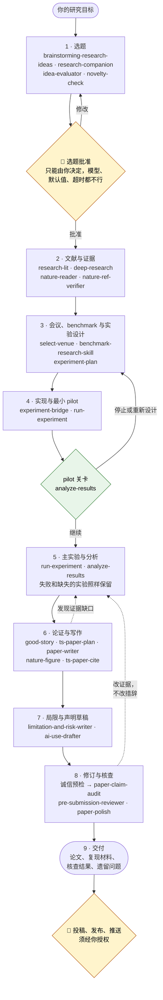

<p align="center">
  
</p>

# Auto-Research System 🔨（自动科研系统）

[](LICENSE) · [](README.md) · [](#-里面有什么) · [](.claude/skills/shared-references/integrity-patterns.md) · [](#-快速开始)

<div align="center">

### 🔨 科研的门槛，吾辈来拆 —— 让每个想去工业界的人都拿得出一篇站得住的论文。

***Research should not be a gate. We take it down, so everyone heading into industry can bring a paper that holds up.***

</div>

> 一套跑在 Claude Code 上的端到端科研系统：从一个研究目标出发，到选定的题目、核实过的
> 文献、设计好并跑过 pilot 的实验、诚实的分析，再到一篇带配图、引用和复现材料、可以投稿的
> 论文。39 个技能、一个科研主控，在要紧的决定处设人工关口。

它能给你什么：

- **整条路，而不是某一步。**选题、文献与新颖性核查、选会议和 benchmark、实验设计、实现与
  pilot、分析、写作、配图、局限与 AI 使用声明草稿、审稿与 rebuttal。每个阶段都是可以单独
  调用的技能，也可以交给主控按顺序跑。
- **先有证据，再有结论。**每个数字都能追到原始结果文件，每条引用都经过核实，结论只说到
  证据撑得住的强度。
- **决定权在你。**选题批准、花钱、租算力、投稿和一切对外动作都等你点头。
- **不绑定厂商。**决策模型、生图服务和外部评审都在本地配置里自选。

---

## 🧭 里面有什么

| | |
|---|---|
| **技能** | 39 个 Claude Code 技能，在 `.claude/skills/`。 |
| **共享科研规则** | 结论保真、按贡献类型分流、目标会议校准、选题、发表/版本规则、科研自主边界、摘要与结论写法、拆分审查，以及[诚信对照表](.claude/skills/shared-references/integrity-patterns.md)。在 `.claude/skills/shared-references/` 下。 |
| **科研主控** | `.claude/skills/research-agent-team/`：一个主 agent 在当前请求范围内协调各阶段；只有你明确开启时，自动模式才跑完整流程。 |
| **决策卡工具** | MCP `choose_card`（`research-agent-team/scripts/clarification_decider.py`），用于自动模式下的普通澄清卡。 |
| **专职 agent** | `.claude/agents/`（分析、架构、实现、质检、编辑、需求；头脑风暴、选题批评、策略）。 |
| **文献工具** | arXiv、OpenAlex、Semantic Scholar、Exa（`.agents/aris/tools/`）。 |
| **Codex 评审桥** | `.agents/mcp-servers/codex-exec/` 下的 MCP 服务，用于跨模型评审（可选，需要 Codex CLI）。 |
| **路由规则** | `CLAUDE.md`。 |

---

## 📰 动态

- **2026-11-01** — 🚀 **v1.0。** 39 个 Claude Code 技能和科研主控；人工关口写进路由规则；
  决策模型、生图服务、外部评审都不绑定厂商；[诚信对照表](.claude/skills/shared-references/integrity-patterns.md)
  把每类论文缺陷对应到负责预防它的阶段；`paper-claim-audit` 开头新增确定性预检（增量算术、
  摘要数字在表里找不到、GRIM、不可能的标准差、p 值与统计量矛盾、重复表格、残留模板串）。

---

## 🗺️ 工作流



默认情况下，每个请求只跑它需要的阶段，做完就停；技能建议的下一步不等于允许继续。
自动模式会沿着这张图跑到约定的终点，但仍会在两个 👤 关口停下等你。综述、理论、立场和
复现类论文会跳过不适用的阶段。

---

## 🚀 快速开始

```bash
git clone <本仓库> research && cd research
./install.sh                 # WITH_DIAGRAMS=1 ./install.sh 会顺带装好示意图渲染
claude
```

`install.sh` 从 `config/*.example.json` 在 `.tools/` 下生成本地配置（不进版本库），
渲染 `.mcp.json`，并安装决策卡客户端。不下载任何模型权重。
需要 Python 3.10+、生图需要 Node 18+，以及 Claude Code。Codex CLI 可选：外部评审和内置生图工具
要靠它。

### 配置（全部可选）

| 组件 | 文件 | 可选项 | 不配置时 |
|---|---|---|---|
| 自动模式的决策模型 | `.tools/clarification-decider/config.json` | 任何返回 `top_logprobs` 的 OpenAI 兼容服务（vLLM、LM Studio、Ollama、llama.cpp、托管网关），或按需运行的本地 GGUF | 由主 agent 在已有授权内决定 |
| 生图 | `.tools/image-provider.json` | Codex 内置 `image_gen`（默认）或 Antigravity 内置 `generate_image`（Nano Banana，`"provider": "antigravity"`）；任何返回图片的 OpenAI 兼容对话端点；另有 Poe、OpenRouter 适配器 | 经 Codex 桥调用内置 `image_gen` 工具；Codex 或该工具不可用时如实报告无法生成 |
| 外部评审 | `.tools/reviewer.json` | Codex MCP（服务商随你的 Codex CLI），或人工评审 | 如实报告外部评审不可用，绝不拿自评顶替 |
| 语言润色（可选） | 无；只在你要求时使用 | 默认 Gemini 4 Argon，经会话中可用的 Gemini 工具调用（Antigravity `agy` MCP 或 Gemini CLI）；只改语言，每处改动审核后才采用 | 由 Claude 润色 |
| 文献 API | 环境变量 | `EXA_API_KEY`、`SEMANTIC_SCHOLAR_API_KEY`、`OPENALEX_EMAIL` | 用免密钥来源，并报告覆盖缺口 |

密钥一律从配置里指定的环境变量读取。手动运行辅助脚本时，把 `RESEARCH_ROOT` 设为仓库
路径。决策模型必须先在你自己的卡片上验证过，才能设 `automatic_selection: true`。

---

## 🎯 为什么做这个

很多想去工业界的人卡在第一篇论文上：方法都懂，但把想法变成经过检查的实验、诚实的
分析、审稿人愿意接收的论文，这套本事很少有人系统地教。agent 能干掉其中很大一部分活，
但放任不管，它也会产出看着写完了、其实站不住的论文：摘要里的数字哪张表都没有、"提升 16%"实际只有
6.7%、baseline 根本没调参、引用查无此文。

这套系统的设计目标是：速度永远不从这些捷径里来。

## 🔒 怎么保证诚实

1. **先有证据，再有结论。** 论文里每个数字都能追到原始结果文件。`paper-claim-audit` 用
   一个全新的、零上下文的跨模型评审，只给它论文源码和原始结果。
2. **改证据，不改措辞。** 一条问题的解决方式只能是：改正数字、补上缺的实验或 baseline、
   或把结论收窄到证据范围内（[结论保真](.claude/skills/shared-references/claim-preservation.md)）。
   改写措辞让检查对不上、缺陷却还在，不算修复。
3. **每类缺陷都有人管。**[诚信对照表](.claude/skills/shared-references/integrity-patterns.md)
   写明每类缺陷（数字、范围、baseline、实验、引用、表面呈现、证明、评测设计）由哪个阶段
   预防、投稿前由哪项检查查出。
4. **预先定好的标准不改。** 看到结果后不经披露不改标准；pilot 失败就停止后续花费；失败和
   缺失的实验留在分析里。
5. **要紧的决定留给人。** 新选题的批准永远等你，任何超时、默认值或模型都放行不了。超出
   授权预算的花费、租算力、推代码、投稿和其他对外动作，也都要你点头。

## 🧭 行为方式

- **一个请求，一个范围。** 技能做完被要求的工作和必要检查就停；技能里写的"下一步"不等于
  允许继续。
- **自动模式**只有你为某个任务明确开启时才跑完整流程。届时普通澄清卡可以由配置的决策模型
  或主 agent 决定。

---

## ⚠️ 局限（信任任何一次运行之前必读）

- **已测试：**决策卡契约（14 项离线测试）、生图适配器（13 项）、诚信预检（干净样例加 8 种
  注入缺陷，以及不带前导零的小数）、nature-response（7 项）和
  nature-shared（5 项）包检查。大多数技能是说明文件，没有自动化行为测试。
- **决策模型**只在 12 张英文合成卡上检查过，只能说明接得通，不能说明它的科研决策准确。
- **诚信预检基于正则抽取。**只能查到抽取器认出的内容，零发现不等于没问题。没装 scipy 时
  只复核 z 检验的 p 值。
- **诚信对照表是预防，不是证明。**所有检查都过了不等于论文正确，审稿人仍可能查出问题。
- **会议规则、截稿日期和排名**必须对照官方页面重新核实。

---

## 🧬 致谢

多个技能改编自开源项目，包括 ARIS、Supervisor-Skills、nature-skills、research-companion 和
AI-Research-SKILLs；诚信预检用了 Anti-Autoresearch 的 4 个 MIT 脚本，做了少量修改。各组件
保留原有声明，完整清单（版本与许可证）见 [`THIRD_PARTY_NOTICES.md`](THIRD_PARTY_NOTICES.md)。

## ⚖️ 许可证

CC BY-NC-SA 4.0（[`LICENSE`](LICENSE)）：可在非商业目的下分享和改编，需署名并以相同许可证
发布。改编自其他项目的组件保留原有声明，见 [`THIRD_PARTY_NOTICES.md`](THIRD_PARTY_NOTICES.md)。
